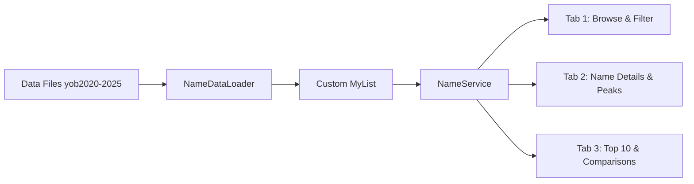

<div align="center">

# 👶 Baby Names Explorer

**Explore and analyze 6 years of US baby names — 100% local, built with pure JavaFX & custom data structures.**

A desktop JavaFX application that loads, validates, and merges US baby-name data (`yob2020.txt` – `yob2025.txt`), combining records by name and gender, and providing powerful browsing, searching, and statistical analysis.


[](LICENSE)


</div>

> **Curious how a name's popularity changed over the years?** Baby Names Explorer is a zero-dependency (beyond JavaFX) desktop app that merges six years of name records into one searchable dataset, with **no database, no internet, and no `java.util` collections** in the core.

---

## ✨ Features

- **Browse & filter**: scroll through every name and filter by gender or by name prefix.
- **Name details & peaks**: pick a name and see its yearly counts and the year it peaked.
- **Top 10 & comparisons**: view the most popular names and compare them side by side.
- **Smart merging**: records from all six files are combined by name and gender into a single entry.
- **Input validation**: malformed lines and invalid values are detected and skipped while loading.
- **Custom data structure**: built on a hand-written `MyList<T>` instead of the standard collections.
- **100% local**: everything runs on your machine, with no network access needed.

---

## 🧭 How It Works



1. **`NameDataLoader`** reads each `yobYYYY.txt` file, validates every line, and parses it.
2. Records are merged by **name + gender** into `BabyName` objects stored in a custom **`MyList`**.
3. **`NameService`** exposes search, filtering, ranking, and statistics to the UI.
4. Three JavaFX tabs present the results.

---

## 📦 Installation

1. **Clone the repository**

```bash
git clone https://github.com/yourusername/baby-names-explorer.git
cd baby-names-explorer
```

2. **Make sure you have the prerequisites**

- [JDK 17+](https://adoptium.net/)
- [JavaFX SDK](https://openjfx.io/) (or a build tool that pulls it in)

3. **Add the data files**

Place `yob2020.txt` through `yob2025.txt` in the `data/` folder:

```
baby-names-explorer/
├── data/
│   ├── yob2020.txt
│   ├── ...
│   └── yob2025.txt
├── src/
└── assets/
```

Each line follows the format:

```
Name,Gender,Count
```

---

## 🚀 Usage

**Compile and run from the command line** (replace the path with your JavaFX SDK `lib` folder):

```bash
javac --module-path /path/to/javafx-sdk/lib --add-modules javafx.controls -d out $(find src -name "*.java")
java  --module-path /path/to/javafx-sdk/lib --add-modules javafx.controls -cp out Main
```

**Or run it from your IDE** (IntelliJ IDEA / Eclipse): add the JavaFX library, set the VM options below, and run `Main`.

```
--module-path /path/to/javafx-sdk/lib --add-modules javafx.controls
```

---

## 🖥️ The Three Tabs

| Tab | What you can do |
|-----|-----------------|
| **1. Browse & Filter** | View all merged names, filter by gender, and search by prefix. |
| **2. Name Details & Peaks** | Select a name to see its count per year and its peak year. |
| **3. Top 10 & Comparisons** | See the top 10 names and compare popularity between names. |

---

## 🗂️ Project Structure

```
src/
├── Main.java            # JavaFX entry point and tab layout
├── BabyName.java        # Model: name, gender, counts per year
├── MyList.java          # Custom generic list implementation
├── NameDataLoader.java  # File reading, validation, merging
└── NameService.java     # Search, filter, ranking, statistics
```

> Adjust file names to match your actual source layout.

---

## 🛠️ Built With

- **Java 17+**
- **JavaFX** for the GUI
- **Custom `MyList<T>`** as the core data structure

---

## 🤝 Contributing

Contributions, issues, and feature requests are welcome!

1. Fork the project
2. Create your branch (`git checkout -b feature/amazing-feature`)
3. Commit your changes (`git commit -m "Add amazing feature"`)
4. Push to the branch (`git push origin feature/amazing-feature`)
5. Open a Pull Request

---

## 📄 License

Distributed under the MIT License. See [`LICENSE`](LICENSE) for details.

---

<div align="center">

⭐ If you found this project useful, consider giving it a star!

</div>
